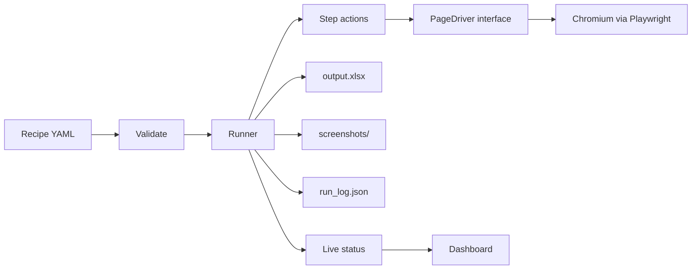

# BrowserForge

**Browser automation you can run from a button.** Describe a repetitive website task once in a
short YAML file. Anyone can then run it from a web dashboard and get back an Excel report,
screenshots of what happened, and a step-by-step log.


<sub>A real run of [`example_login_scrape.yaml`](recipes/example_login_scrape.yaml) against a public practice site.
The amber notice is intentional: the recipe caps the scrape at 3 pages, and the tool says so instead of
quietly returning partial data.</sub>


---

## What problem does this solve?

Many businesses have people doing the same thing in a web portal every day or week: logging in,
clicking through to a report, downloading a file, copying a table into Excel, or typing the same
data into a form. It is slow, easy to get wrong, and leaves no record of what was done.

BrowserForge automates that kind of work:

- **A recipe per site, not a script per task.** A recipe lists the steps (open, log in, fill,
  click, download, scrape, screenshot). Changing a value or adding a step is editing text, not
  programming.
- **Run by someone non-technical.** Pick a recipe, press **Run**, watch progress, download the
  result.
- **Evidence for every run.** Each run leaves an Excel file, a screenshot trail and a JSON log
  with every step, its result and how long it took. If something fails you see which step and why,
  in plain language, with a screenshot of the page at that moment.

### Where it fits

It suits tasks that are **repetitive, rule-based, and done through a website that has no usable
API**. These are typical use cases for this approach (a guide to where it fits, not a list of past
clients):

| Kind of task | What the automation does |
|---|---|
| HR / payroll portals | Log in, download the monthly attendance or payslip files, save them by date |
| Government or partner portals | Fill the same form for many records, screenshot each confirmation page |
| CRM or admin panels | Bulk-update records from a list instead of clicking through each one |
| Internal dashboards | Pull a report on a schedule you choose to run it, export to Excel |
| Repetitive data entry | Type the same fields into a web form from a spreadsheet |
| Public data collection | Read tables across many pages into one Excel file (where the site's terms allow it) |

### When it is *not* the right tool

Being clear about this saves you money:

- If the system has a proper **API or a data export**, use that. It is more reliable than driving a browser.
- Sites protected by **captchas** are out of scope; the tool does not try to bypass them.
- Tasks that need **human judgement** at each step are not good automation candidates.
- Browser automation depends on how a page is built. **If a site redesigns its pages, the recipe
  needs updating.** That is normal maintenance for this kind of automation, not a defect.

### The time-saving arithmetic

This is arithmetic, not a promise. If someone spends **30 minutes a day** on a portal task, that is
about **125 hours over 250 working days**. Your numbers will differ. The sensible first step is to
measure how long the manual task takes now, and how often it happens, before deciding whether
automating it is worth it. Tasks that are short and rare usually are not.

---

## See it work

A failed run reports what went wrong in plain language and keeps a screenshot of the page at
that moment. Here the recipe uses a wrong password:


<sub>The screenshot in the Results panel is the real login page showing the site's own error banner.
The technical detail (raw error, attempts, timings) is kept separately in `run_log.json`.</sub>

A 2-minute walkthrough for showing it to someone else is in [`docs/DEMO.md`](docs/DEMO.md).

## A recipe in 30 seconds

```yaml
url: https://portal.example.com/login
retries: 2                               # retry slow steps; a rejected login is never retried

login:
  username_selector: "#username"
  password_selector: "#password"
  submit_selector: "button[type=submit]"
  username: alice
  password: s3cret
  success_url_contains: /dashboard

steps:
  - type: click
    name: open_reports
    selector: "a.reports"

  - type: paginate                       # read a table across pages into one sheet
    name: Invoices
    selector: table.invoices
    next_selector: 'a[aria-label="Next"]'
    max_pages: 10

  - type: screenshot
    name: last_page
```

Twelve step types cover the common cases: `goto`, `fill`, `click`, `select_option`, `check`,
`login`, `upload`, `download`, `screenshot`, `extract_table`, `paginate`, `wait_for_selector`.
Full reference [below](#writing-recipes).

## How a run works



Every job gets its own folder:

```
jobs/<id>/
  output.xlsx       scraped tables, one sheet per table step
  screenshots/      a photo trail, plus one automatic screenshot when a step fails
  downloads/        files the recipe downloaded
  run_log.json      every step: result, timing, attempts, raw and plain-language error
```

---

## How it is built

This section is for anyone reviewing the code. Everything listed is in the repository and covered
by tests.

**Architecture**
- The engine talks to the browser only through a small `PageDriver` interface. All logic
  (recipes, actions, retries, pagination, Excel export) runs against a **fake driver in unit
  tests**, so they finish in seconds without a browser. The real `PlaywrightDriver` is the single
  module that imports Playwright.
- Pure functions for data shaping (`table_extract`, `pagination`, `excel_export`), kept separate
  from side effects so they are easy to test and reason about.
- A FastAPI app that contains routes only; job state, status building and file lookup live in
  their own modules.

**Reliability**
- **Retries with back-off, but only for temporary failures.** A slow page is retried; a bad recipe
  setting or a **rejected login is never retried**, so a wrong password cannot lock an account.
- **Bounded pagination.** A `max_pages` cap stops a site whose "Next" button never ends, and the
  result is flagged as truncated so partial data is never mistaken for complete data.
- **Best-effort failure screenshots.** If the screenshot itself fails, the original error is still
  the one reported.
- Each job runs in its own worker thread with its own browser.

**Security**
- Scraped text is written to Excel as text, so a cell like `=HYPERLINK(...)` from a website cannot
  become a live formula.
- File-serving routes resolve every path and refuse anything outside the job folder (tests cover
  `..`, encoded traversal, absolute paths and symlinks).
- The dashboard inserts server text as plain text only, never as HTML; a test in a real browser
  confirms markup in a step name does not run.
- Passwords are redacted from error messages and never written to logs or `run_log.json`.
- Uploaded recipes are validated, size-limited and stored under sanitised names; `recipes/` is
  git-ignored except the examples.

**Testing: 700+ automated tests**
- **Unit tests** (fast, no browser or network) cover the engine, API, job store and status shapes.
- **Integration tests** drive real Chromium: the driver against a local test website, the whole
  dashboard in a browser, and the two example recipes on public practice sites (skipped
  automatically when offline).
- They have caught real bugs. One example: on a real site, a page that loaded slowly looked like a
  short table with no "Next" link, so pagination stopped early with partial data. It was
  reproduced with a deliberately slow test page, fixed in the driver, and now has a regression
  test.

**Tooling**
- Everything is managed with [`uv`](https://docs.astral.sh/uv/): dependencies, the lockfile, the
  Python version, running tests and the app. No `pip`, no `requirements.txt`.
- `ruff` for lint and formatting, `mypy --strict` for types, structured logging with `structlog`
  (each log line carries the job id).

| Area | Tools |
|---|---|
| Language | Python 3.13 |
| Browser automation | Playwright (Chromium) |
| Dashboard / API | FastAPI, Uvicorn, plain HTML/JS (no front-end framework, no external assets) |
| Data / Excel | openpyxl, PyYAML |
| Logging | structlog (console or JSON lines, rotating file) |
| Quality | pytest, ruff, mypy (strict), uv |

---

## Quick start

```
# install uv once (Windows PowerShell; macOS/Linux: curl -LsSf https://astral.sh/uv/install.sh | sh)
powershell -c "irm https://astral.sh/uv/install.ps1 | iex"

uv sync                                # install dependencies exactly as locked
uv run playwright install chromium     # download the browser (once per machine)
uv run browserforge                    # start the dashboard
```

Open <http://127.0.0.1:8000>. Options: `--port`, `--recipes-dir`, `--jobs-dir`, `--json-logs`,
`--reload` (see `uv run browserforge --help`). Start it from the project folder, because relative
paths in recipes (such as an upload file) are resolved from there.

> Developed and tested on Windows 11. The tooling is cross-platform, but I have not run it on
> macOS or Linux.

**Using the dashboard:** choose or upload a recipe, press **Run**, watch the step table update
every 2 seconds, then download the Excel report and open the screenshots. Invalid recipes are
rejected with a message saying what to fix.

<a id="writing-recipes"></a>
<details>
<summary><strong>Writing recipes: full reference</strong></summary>

Top-level settings: `url` (required, opened first), `login` (optional), `steps`, `retries`
(0-10, default 0), `backoff_seconds` (wait 1s, 2s, 4s... between retries, default 1),
`continue_on_error` (default `false`: stop at the first failed step).

Every step has a `type`, may have a `name` (used in the log, screenshot file names and Excel sheet
names), and may override `retries` / `backoff_seconds`.

| `type` | What it does | Settings |
|---|---|---|
| `goto` | Open a URL | `url` |
| `fill` | Type into a field | `selector`, `value` |
| `click` | Click an element | `selector` |
| `select_option` | Choose from a dropdown | `selector`, `value` |
| `check` | Tick a checkbox | `selector` |
| `login` | Fill credentials, submit, wait for the logged-in page | as in the `login:` block; optional `timeout_ms` |
| `upload` | Attach file(s) to a file input | `selector`, `files` (one path or a list) |
| `download` | Click something that starts a download and save the file | `selector`, optional `save_as` |
| `screenshot` | Save a PNG (whole page, or one element) | optional `selector`, `full_page` |
| `extract_table` | Read one table into the Excel report | `selector`, optional `has_header` |
| `paginate` | Read a table across pages by clicking "Next" | `selector`, `next_selector`, optional `max_pages` (default 50), `has_header` |
| `wait_for_selector` | Wait until an element appears | `selector`, optional `timeout_ms` |

Notes:
- **Selectors** are CSS selectors. Right-click an element, choose *Inspect*, and copy a short,
  stable one (an `id` is best). `uvx playwright codegen <url>` records clicks and shows the
  selectors Playwright would use.
- **Missing upload files fail immediately**, naming the file, before the browser is touched.
- **Recipes hold passwords in plain text.** The dashboard has no login and is meant to run on your
  own machine (it listens on `127.0.0.1` by default). Do not expose it to a network.

Example recipes, both runnable against public practice sites with no setup:
[`example_login_scrape.yaml`](recipes/example_login_scrape.yaml) (log in, paginated scrape, Excel)
and [`example_form_fill.yaml`](recipes/example_form_fill.yaml) (fill, dropdown, checkbox, upload).

</details>

<details>
<summary><strong>Running the tests, managing dependencies, project layout</strong></summary>

```
uv run pytest                            # unit tests: no browser, no network
uv run pytest -m integration             # real Chromium (needs the browser installed)
uv run pytest -m "unit or integration"   # everything
uv run ruff check .   &&   uv run ruff format --check .   &&   uv run mypy src tests
```

```
uv add <package>                # add a runtime dependency (uv add --group dev <p> for dev-only)
uv remove <package>
uv lock --upgrade && uv sync    # upgrade within version limits
```

```
src/browserforge/
  app.py               FastAPI routes only
  jobs.py              in-memory job store, status JSON, background job body
  results.py           list a job's files as URLs; safe file lookup
  cli.py               `uv run browserforge`
  logging_config.py    structlog setup
  templates/dashboard.html
  engine/
    recipe.py          YAML -> validated Recipe
    runner.py          runs steps; retries, failure screenshots, run_log.json, Excel
    actions.py         one function per step type
    driver.py          PageDriver interface + PlaywrightDriver (only module using playwright)
    errors.py          failure kinds and plain-language messages
    pagination.py, table_extract.py, excel_export.py
recipes/               example recipes (and dashboard uploads, git-ignored)
tests/unit/            fast tests against a fake driver
tests/integration/     real browser tests
```

</details>

<details>
<summary><strong>Troubleshooting</strong></summary>

| Symptom | Fix |
|---|---|
| "The browser is not installed on this computer" | `uv run playwright install chromium` |
| "Couldn't find or use '#x' within 30 seconds" | The selector is wrong or the page changed. Check it in the browser inspector, or add a `wait_for_selector` step first. |
| "The page address never changed to what was expected" after a login | Wrong credentials, or the site redirects elsewhere. Check `success_url_contains` / `success_selector`. |
| A scrape ends with a "cut off" warning | `max_pages` was reached. Raise it. |
| The Excel report could not be saved | `output.xlsx` is open in Excel. Close it and run again. |

Technical detail for any failure is in `jobs/<id>/run_log.json` and the server log.

</details>

---

## Scope and limitations

Stated plainly, so expectations are right:

- **Single-user, local tool.** No user accounts or login on the dashboard.
- **Job history is in memory.** After a restart the dashboard forgets past runs, although their
  files remain in `jobs/`.
- **No scheduling, email reports or Docker packaging yet.** Runs start from the dashboard. These
  are natural next steps, not part of this version.
- **Chromium only.** No captcha solving. No visual recipe builder; recipes are written as YAML.
- **Sites change.** Recipes need updating when a site's layout changes.
- **Use it responsibly.** Automate only accounts and sites you are authorised to use, and respect
  their terms of service.

## Working with me

I build and maintain automations like this for specific websites and workflows: writing and testing
the recipe for your portal, delivering it as this dashboard or as scripts, and updating it when the
site changes.

A typical engagement:

1. **You describe the task** and how often it runs, and share a test account (never a production
   password over email or chat).
2. **I check it is a good fit** and estimate the effort honestly, including when the answer is
   "use the API instead" or "this is not worth automating".
3. **I build and test the recipe**, and show you a real run with the screenshots and log.
4. **Handover**, with the recipe, instructions, and an agreed way to handle changes to the site.

To get in touch, message me on GitHub: [@aksh-nishar](https://github.com/aksh-nishar).
