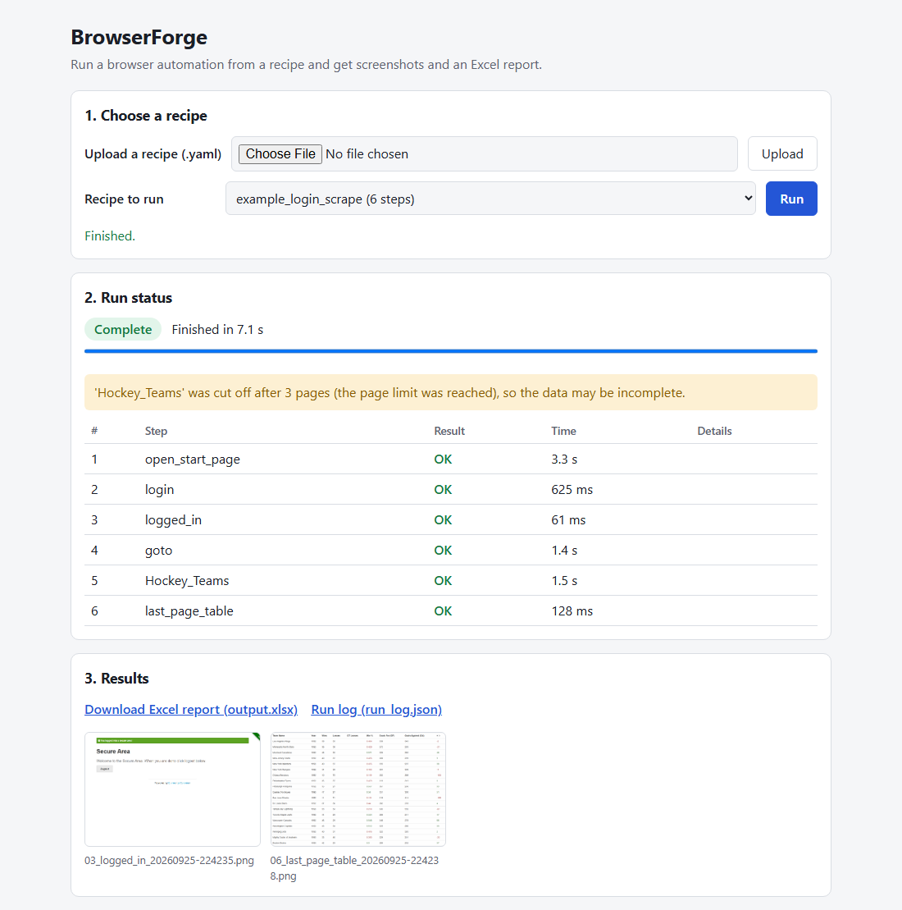
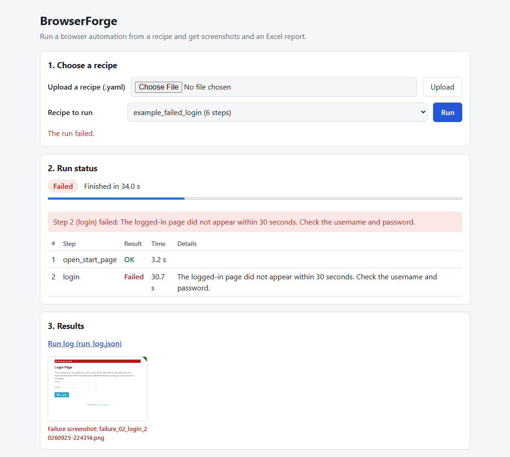
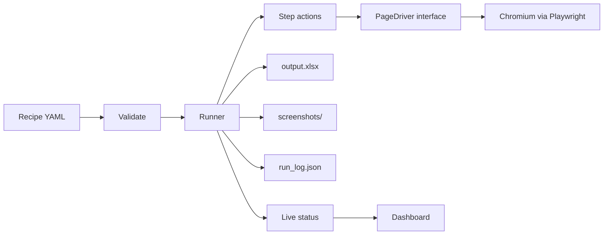
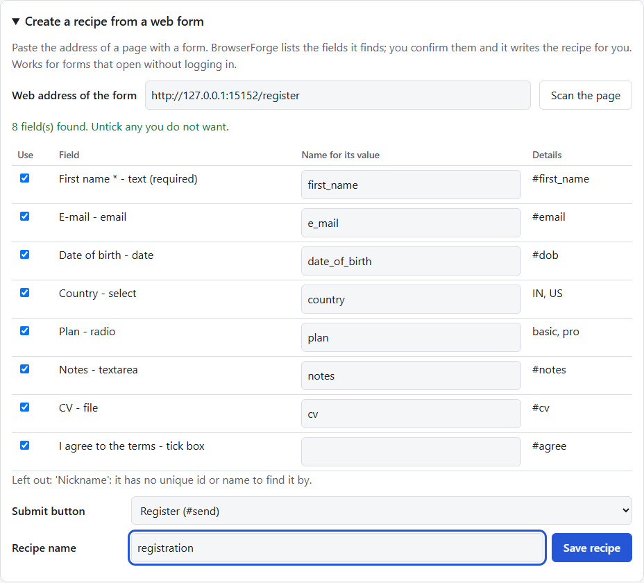
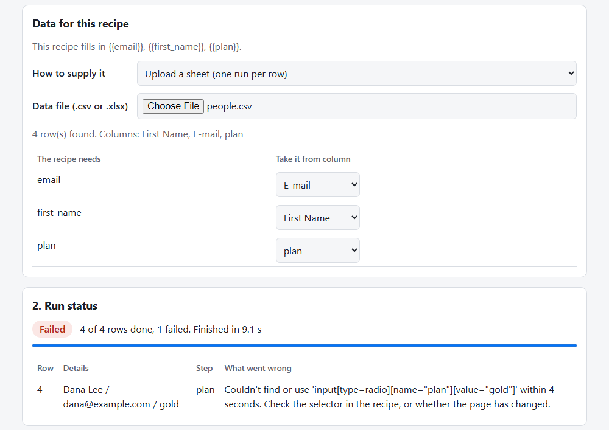
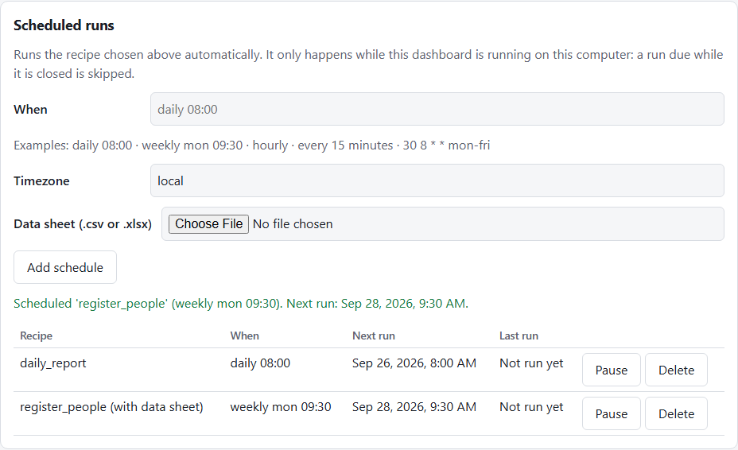

# BrowserForge

**Browser automation you can run from a button.** Describe a repetitive website task once in a
short YAML file, or let BrowserForge write the recipe from a form's web address. Anyone can then
run it from a web dashboard, for one person or for every row of a spreadsheet, on demand or on a
schedule, and get back an Excel report, screenshots of what happened, and a step-by-step log.



<sub>A real run of [`example_login_scrape.yaml`](recipes/example_login_scrape.yaml) against a public practice site.
The amber notice is intentional: the recipe caps the scrape at 3 pages, and the tool says so instead of
quietly returning partial data.</sub>


---

## What problem does this solve?

Many businesses have people doing the same thing in a web portal every day or week: logging in,
clicking through to a report, downloading a file, copying a table into Excel, or typing the same
data into a form. It is slow, easy to get wrong, and leaves no record of what was done.

BrowserForge automates that kind of work:

- **A recipe per site, not a script per task.** A recipe lists the steps (open, log in, fill,
  click, download, scrape, screenshot). Changing a value or adding a step is editing text, not
  programming.
- **Run by someone non-technical.** Pick a recipe, press **Run**, watch progress, download the
  result.
- **Evidence for every run.** Each run leaves an Excel file, a screenshot trail and a JSON log
  with every step, its result and how long it took. If something fails you see which step and why,
  in plain language, with a screenshot of the page at that moment.

### Where it fits

It suits tasks that are **repetitive, rule-based, and done through a website that has no usable
API**. These are typical use cases for this approach (a guide to where it fits, not a list of past
clients):

| Kind of task | What the automation does |
|---|---|
| HR / payroll portals | Log in, download the monthly attendance or payslip files, save them by date |
| Government or partner portals | Fill the same form for many records from a sheet, screenshot each confirmation page |
| CRM or admin panels | Bulk-update records from a list instead of clicking through each one |
| Internal dashboards | Pull a report on a schedule (for example every morning), export to Excel |
| Repetitive data entry | Type the same fields into a web form from a spreadsheet, one run per row |
| Public data collection | Read tables across many pages into one Excel file (where the site's terms allow it) |

### When it is *not* the right tool

Being clear about this saves you money:

- If the system has a proper **API or a data export**, use that. It is more reliable than driving a browser.
- Sites protected by **captchas** or **two-factor login** are out of scope; the tool does not try
  to bypass them. (The form scanner warns you when it sees a CAPTCHA on the page.)
- Tasks that need **human judgement** at each step are not good automation candidates.
- **One-off tasks.** Filling a single form once is faster by hand than setting anything up. The
  tool pays off when the same task repeats, or covers many records.
- Browser automation depends on how a page is built. **If a site redesigns its pages, the recipe
  needs updating.** That is normal maintenance for this kind of automation, not a defect.

### The time-saving arithmetic

This is arithmetic, not a promise. If someone spends **30 minutes a day** on a portal task, that is
about **125 hours over 250 working days**. Your numbers will differ. The sensible first step is to
measure how long the manual task takes now, and how often it happens, before deciding whether
automating it is worth it. Tasks that are short and rare usually are not.

### How it saves time: three examples

The times below are **illustrative assumptions**, not measurements or promises. Replace them with
your own before deciding anything.

**1. A coaching institute registering 150 students on an exam portal**
- *The problem:* a staff member retypes each student's details from an Excel sheet into the
  portal's form. At about 5 minutes a form that is **12+ hours**, and a typo can mean a rejected
  application.
- *With BrowserForge:* the recipe for that form is made once (by hand, or generated from the
  form's address, see [below](#create-a-recipe-from-a-web-form)). Staff upload the sheet and press
  **Run**: the form is filled and submitted once per row, unattended.
- *What they get:* a report saying which rows went through and which failed and why, plus a
  screenshot of every confirmation page. Failed rows are named, so only those are redone.

**2. A company pulling a supplier's price list every morning**
- *The problem:* an employee logs in to the supplier portal, opens a 20-page price list and copies
  it into Excel. At about 40 minutes a day that is roughly **15 hours a month**.
- *With BrowserForge:* one recipe (log in, read the table across pages, export to Excel) scheduled
  for `daily 08:00`. The Excel file is waiting when the employee arrives.
- *Caveat:* it works with a plain username-and-password login, and the dashboard has to be running
  on a computer that is switched on at that time (see [Scheduled runs](#scheduled-runs)).

**3. A freelancer or agency updating 300 product listings in a client's admin panel**
- *The problem:* the client sends a sheet of 300 rows and expects the admin panel to match it.
  By hand it is slow, boring work that is easy to get wrong.
- *With BrowserForge:* one recipe for the edit form, one sheet, one run. A **test run** first (it
  fills everything in but stops before the save button) shows the client what will happen. Then
  the real run, with a per-row report and a screenshot trail as proof of what was changed.

**Who it fits:** back-office and HR teams, accountants, e-commerce sellers, training institutes,
and agencies or freelancers who do this kind of data entry for clients.

---

## See it work

A failed run reports what went wrong in plain language and keeps a screenshot of the page at
that moment. Here the recipe uses a wrong password:



<sub>The screenshot in the Results panel is the real login page showing the site's own error banner.
The technical detail (raw error, attempts, timings) is kept separately in `run_log.json`.</sub>

A 2-minute walkthrough for showing it to someone else is in [`docs/DEMO.md`](docs/DEMO.md).

## A recipe in 30 seconds

```yaml
url: https://portal.example.com/login
retries: 2                               # retry slow steps; a rejected login is never retried

login:
  username_selector: "#username"
  password_selector: "#password"
  submit_selector: "button[type=submit]"
  username: alice
  password: s3cret
  success_url_contains: /dashboard

steps:
  - type: click
    name: open_reports
    selector: "a.reports"

  - type: paginate                       # read a table across pages into one sheet
    name: Invoices
    selector: table.invoices
    next_selector: 'a[aria-label="Next"]'
    max_pages: 10

  - type: screenshot
    name: last_page
```

Thirteen step types cover the common cases: `goto`, `fill`, `click`, `select_option`, `check`,
`choose`, `login`, `upload`, `download`, `screenshot`, `extract_table`, `paginate`,
`wait_for_selector`. Values can be `{{placeholders}}` filled in from a spreadsheet (see
[Fill forms from a spreadsheet](#fill-forms-from-a-spreadsheet)). Full reference
[below](#writing-recipes).

## How a run works



Every job gets its own folder:

```
jobs/<id>/
  output.xlsx       scraped tables, one sheet per table step
  screenshots/      a photo trail, plus one automatic screenshot when a step fails
  downloads/        files the recipe downloaded
  run_log.json      every step: result, timing, attempts, raw and plain-language error
```

A run over a spreadsheet keeps the same files for **each row** in `row_0001/`, `row_0002/` ...
inside the job folder, and adds a `Run_Report` sheet to `output.xlsx` and a per-row summary in
`run_log.json`.

---

## Feature guide

<a id="create-a-recipe-from-a-web-form"></a>
### Create a recipe from a web form

You do not have to write selectors by hand. In the dashboard, open **Create a recipe from a web
form**, paste the address of the page and press **Scan the page**.



- BrowserForge opens the page, lists every field it can fill (text, e-mail, date, dropdown, radio
  buttons, text area, file upload, checkbox) and finds a selector for each one that matches exactly
  one element. A field with no unique id or name is left out, and the page says which and why.
- You untick what you do not want, rename the `{{placeholder}}` for each value if you like, pick the
  submit button, name the recipe and press **Save recipe**.
- The recipe uses `{{placeholders}}` instead of fixed values, so the same recipe runs for one
  person (typed into the dashboard) or for every row of a sheet.
- After the fields the recipe takes a screenshot, clicks the submit button (that step is marked
  `submit: true`) and takes another screenshot. Tick **Test run** to fill in everything but stop
  before that click: check the screenshot, then run it for real.

Limits, stated plainly: it works for forms that open without logging in, on one page. Fields inside
iframes or shadow DOM are not detected, and multi-page wizards and CAPTCHAs are not supported. The
scan warns you about iframes, shadow DOM, CAPTCHAs and password fields it sees on the page.

<a id="fill-forms-from-a-spreadsheet"></a>
### Fill forms from a spreadsheet

Put `{{name}}` wherever a value should come from the data (in `url`, `login` or any step setting):

```yaml
url: https://portal.example.com/register
steps:
  - type: fill
    selector: "#first_name"
    value: "{{first_name}}"
  - type: fill
    selector: "#email"
    value: "{{email}}"
  - type: choose                       # a radio group: pick the option with this value
    selector: 'input[type=radio][name="plan"]'
    value: "{{plan}}"
  - type: click
    selector: "#send"
    submit: true                       # a test run stops before this step
```

Then choose **Upload a sheet** in the dashboard and give it a `.csv` or `.xlsx` file whose first row
holds the column names:

| First Name | E-mail | plan |
|---|---|---|
| Asha Rao | asha@example.com | basic |
| Ben Ortiz | ben@example.com | pro |



- **Column names are matched to placeholders for you**, ignoring case and punctuation (`E-mail`
  fills `{{email}}`). The dashboard shows the match and lets you change it. On the command line
  use `--map email="E-mail"`.
- **The data is checked before any browser opens.** A missing column or a blank cell is reported
  with its row number ("Row 2: no value for 'email'"), and nothing runs.
- **One run per row, in its own browser page.** A row that fails is recorded (with a screenshot)
  and the next row still runs. The `Run_Report` sheet in `output.xlsx` lists every row's status,
  failed step and reason.
- **Typed values instead of a sheet** run the recipe once; the dashboard builds the input boxes
  from the recipe's placeholders and masks any that look like secrets.
- Limits: at most 1,000 rows and 5 MB per file. `.xlsx` numbers and dates are read as text.

**Passwords and other secrets.** Do not put them in a recipe or a sheet you keep. Use
`{{env:PORTAL_PASSWORD}}` in the recipe and set that environment variable on the computer running
BrowserForge. The value is read when the run starts, and every secret (an environment value, or a
column that looks like a password, PIN or token) is replaced by `***` in error messages, logs,
`run_log.json` and the report.

<a id="scheduled-runs"></a>
### Scheduled runs

Runs the recipe chosen in the dashboard automatically, on a schedule.



- **Write when in plain words:** `daily 08:00`, `weekly mon 09:30`, `hourly`, `every 15 minutes`
  (5 minutes or more), `every 2 hours`, or a 5-field cron line such as `30 8 * * mon-fri` (day
  names, not numbers, to avoid Sunday/Monday confusion). The timezone defaults to this computer's;
  set another with a name like `Asia/Kolkata`.
- A recipe with `{{placeholders}}` takes a data sheet, saved with the schedule and checked when you
  add it. **Saved schedules refuse secret-looking columns**; use `{{env:NAME}}` instead.
- **Pause, resume and delete** from the same card. Schedules are kept in `data/schedules.json` and
  come back after a restart. The card shows the next run time and how the last run ended.
- **It runs only while the dashboard is running.** A run that was due while the program was closed
  is skipped, not replayed later. A schedule whose previous run is still going is skipped rather
  than started twice, and the card says so. If you need runs without a window open, keep BrowserForge
  running on an always-on machine, or start `uv run browserforge run <recipe>` from the operating
  system's own scheduler (Windows Task Scheduler, cron).

### Saved profiles

For a recipe you fill in by typing, save one person's details as a **profile** (for example
`Aksh`) and reuse them later: choose the profile and the matching boxes fill in. Names are matched
loosely, like sheet columns. Anything left over is listed so you can type it.

Profiles are stored in `data/profiles.json` on your computer. **Fields that look like secrets
(passwords, PINs, tokens, ID numbers) are never saved** and are never filled from a profile.

### Command line

```
uv run browserforge run <recipe> [--data people.csv] [--map placeholder=column]
                                 [--dry-run] [--headed]
```

Runs one recipe without the dashboard and exits with `0` when every step (and every row) succeeded,
`1` when something failed and `2` when the request itself was wrong (unknown recipe, bad data). The
recipe is a name in `recipes/` or a path to a `.yaml` file. Results go to `jobs/<id>/` as usual.

---

## How it is built

This section is for anyone reviewing the code. Everything listed is in the repository and covered
by tests.

**Architecture**
- The engine talks to the browser only through a small `PageDriver` interface. All logic
  (recipes, actions, retries, pagination, Excel export) runs against a **fake driver in unit
  tests**, so they finish in seconds without a browser. The real `PlaywrightDriver` is the single
  module that imports Playwright.
- Pure functions for data shaping (`table_extract`, `pagination`, `excel_export`), kept separate
  from side effects so they are easy to test and reason about.
- A FastAPI app that contains routes only; job state, status building and file lookup live in
  their own modules.

**Reliability**
- **Retries with back-off, but only for temporary failures.** A slow page is retried; a bad recipe
  setting or a **rejected login is never retried**, so a wrong password cannot lock an account.
- **Bounded pagination.** A `max_pages` cap stops a site whose "Next" button never ends, and the
  result is flagged as truncated so partial data is never mistaken for complete data.
- **Best-effort failure screenshots.** If the screenshot itself fails, the original error is still
  the one reported.
- Each job runs in its own worker thread with its own browser.

**Security**
- Scraped text is written to Excel as text, so a cell like `=HYPERLINK(...)` from a website cannot
  become a live formula.
- File-serving routes resolve every path and refuse anything outside the job folder (tests cover
  `..`, encoded traversal, absolute paths and symlinks).
- The dashboard inserts server text as plain text only, never as HTML; a test in a real browser
  confirms markup in a step name does not run.
- Passwords are redacted from error messages and never written to logs or `run_log.json`. The same
  goes for `{{env:NAME}}` values and for cells in secret-looking columns (password, PIN, token...)
  of a data sheet.
- Saved schedules and profiles never hold secrets: secret-looking columns and fields are refused
  or dropped, and a scheduled run reads secrets from the environment when it fires.
- Data sheets are read in memory and checked before any browser opens; schedule sheets are stored
  under a fixed file name, never one taken from the upload.
- The form scanner only opens `http://` and `https://` addresses, and page text (labels, ids) can
  never become a `{{placeholder}}` in a generated recipe.
- Uploaded recipes are validated, size-limited and stored under sanitised names; `recipes/` and
  `data/` are git-ignored (only the example recipes are tracked).

**Testing: 1,400+ automated tests** (about 1,340 unit and 67 integration)
- **Unit tests** (fast, no browser or network) cover the engine, API, job store, status shapes,
  spreadsheet parsing, the schedule parser, the form scanner's planning and the stores that keep
  schedules and profiles.
- **Integration tests** drive real Chromium: the driver against a local test website (including a
  full registration form that records what it receives), the whole dashboard in a browser, scanning
  a form and running the recipe it generates, bulk runs over a sheet, a real scheduler firing a
  real job, and the two example recipes on public practice sites (skipped automatically when
  offline).
- They have caught real bugs. One example: on a real site, a page that loaded slowly looked like a
  short table with no "Next" link, so pagination stopped early with partial data. It was
  reproduced with a deliberately slow test page, fixed in the driver, and now has a regression
  test.

**Tooling**
- Everything is managed with [`uv`](https://docs.astral.sh/uv/): dependencies, the lockfile, the
  Python version, running tests and the app. No `pip`, no `requirements.txt`.
- `ruff` for lint and formatting, `mypy --strict` for types, structured logging with `structlog`
  (each log line carries the job id).

| Area | Tools |
|---|---|
| Language | Python 3.13 |
| Browser automation | Playwright (Chromium) |
| Dashboard / API | FastAPI, Uvicorn, plain HTML/JS (no front-end framework, no external assets) |
| Data / Excel | openpyxl, PyYAML |
| Scheduling | APScheduler (in-process) |
| Logging | structlog (console or JSON lines, rotating file) |
| Quality | pytest, ruff, mypy (strict), uv |

---

## Quick start

```
# install uv once (Windows PowerShell; macOS/Linux: curl -LsSf https://astral.sh/uv/install.sh | sh)
powershell -c "irm https://astral.sh/uv/install.ps1 | iex"

uv sync                                # install dependencies exactly as locked
uv run playwright install chromium     # download the browser (once per machine)
uv run browserforge                    # start the dashboard
```

Open <http://127.0.0.1:8000>. Options: `--port`, `--recipes-dir`, `--jobs-dir`, `--data-dir`
(schedules, saved data sheets and profiles; default `data/`), `--json-logs`, `--reload` (see
`uv run browserforge --help`). Start it from the project folder, because relative paths in recipes
(such as an upload file) are resolved from there.

> Developed and tested on Windows 11. The tooling is cross-platform, but I have not run it on
> macOS or Linux.

**Using the dashboard:** choose or upload a recipe (or [create one from a web
form](#create-a-recipe-from-a-web-form)), give it its data if it has `{{placeholders}}`, press
**Run**, watch the step table (or, for a spreadsheet, the row counter) update every 2 seconds, then
download the Excel report and open the screenshots. Invalid recipes are rejected with a message
saying what to fix.

<a id="writing-recipes"></a>
<details>
<summary><strong>Writing recipes: full reference</strong></summary>

Top-level settings: `url` (required, opened first), `login` (optional), `steps`, `retries`
(0-10, default 0), `backoff_seconds` (wait 1s, 2s, 4s... between retries, default 1),
`continue_on_error` (default `false`: stop at the first failed step).

Every step has a `type`, may have a `name` (used in the log, screenshot file names and Excel sheet
names), and may override `retries` / `backoff_seconds`. A step marked `submit: true` is the one
that sends a form: a **test run** (dashboard checkbox, or `--dry-run`) replaces it with a screenshot
and skips everything after it. A test run of a recipe with no such step is refused, so it can never
submit by accident.

| `type` | What it does | Settings |
|---|---|---|
| `goto` | Open a URL | `url` |
| `fill` | Type into a field | `selector`, `value` |
| `click` | Click an element | `selector` |
| `select_option` | Choose from a dropdown | `selector`, `value` |
| `check` | Tick a checkbox (or a single radio button) | `selector` |
| `choose` | Pick one radio button of a group by its value | `selector` (the group, such as `input[name=plan]`, one selector without commas), `value` |
| `login` | Fill credentials, submit, wait for the logged-in page | as in the `login:` block; optional `timeout_ms` |
| `upload` | Attach file(s) to a file input | `selector`, `files` (one path or a list) |
| `download` | Click something that starts a download and save the file | `selector`, optional `save_as` |
| `screenshot` | Save a PNG (whole page, or one element) | optional `selector`, `full_page` |
| `extract_table` | Read one table into the Excel report | `selector`, optional `has_header` |
| `paginate` | Read a table across pages by clicking "Next" | `selector`, `next_selector`, optional `max_pages` (default 50), `has_header` |
| `wait_for_selector` | Wait until an element appears | `selector`, optional `timeout_ms` |

Notes:
- **Other form fields need no special step.** Dates (`value: 2000-01-31`) and text areas are
  filled with `fill`; dropdown options are picked by value or by visible text with `select_option`.
- **`{{placeholders}}`** may appear in `url`, `login` and any step setting. `{{name}}` is read from
  the data (a sheet row or typed values); `{{env:NAME}}` from an environment variable. A recipe
  that uses them cannot run until the values are supplied, and says which are missing.
- **Selectors** are CSS selectors. Right-click an element, choose *Inspect*, and copy a short,
  stable one (an `id` is best). `uvx playwright codegen <url>` records clicks and shows the
  selectors Playwright would use.
- **Missing upload files fail immediately**, naming the file, before the browser is touched.
- **Recipes hold passwords in plain text.** The dashboard has no login and is meant to run on your
  own machine (it listens on `127.0.0.1` by default). Do not expose it to a network.

Example recipes, both runnable against public practice sites with no setup:
[`example_login_scrape.yaml`](recipes/example_login_scrape.yaml) (log in, paginated scrape, Excel)
and [`example_form_fill.yaml`](recipes/example_form_fill.yaml) (fill, dropdown, checkbox, upload).

</details>

<details>
<summary><strong>Running the tests, managing dependencies, project layout</strong></summary>

```
uv run pytest                            # unit tests: no browser, no network
uv run pytest -m integration             # real Chromium (needs the browser installed)
uv run pytest -m "unit or integration"   # everything
uv run ruff check .   &&   uv run ruff format --check .   &&   uv run mypy src tests
```

```
uv add <package>                # add a runtime dependency (uv add --group dev <p> for dev-only)
uv remove <package>
uv lock --upgrade && uv sync    # upgrade within version limits
```

```
src/browserforge/
  app.py               FastAPI routes only
  jobs.py              in-memory job store, status JSON, background job bodies (single and bulk)
  results.py           list a job's files as URLs; safe file lookup
  cli.py               `uv run browserforge` (dashboard) and `browserforge run` (one recipe)
  data_input.py        sheet / typed values / column mapping -> checked rows for a run
  schedule.py          schedule text -> cron, next run times, the fire-or-skip decision (pure)
  schedule_store.py    data/schedules.json and each schedule's saved data sheet
  scheduler.py         APScheduler wiring and "start a job from a schedule"
  profiles.py          saved profiles: rules, matching, data/profiles.json
  jsonfile.py          atomic JSON read/write that keeps unreadable files aside
  recipe_files.py      finding recipe files by name
  logging_config.py    structlog setup
  templates/dashboard.html
  engine/
    recipe.py          YAML -> validated Recipe
    runner.py          runs steps; retries, failure screenshots, test runs, run_log.json, Excel
    bulk.py            one recipe run per data row, per-row folders, Run_Report
    data_rows.py       CSV/XLSX rows, {{placeholders}}, mapping, secrets (pure)
    form_scan.py       scanned form -> selectors -> recipe (pure)
    actions.py         one function per step type
    driver.py          PageDriver interface + PlaywrightDriver (only module using playwright)
    errors.py          failure kinds and plain-language messages
    pagination.py, table_extract.py, excel_export.py
recipes/               example recipes (and dashboard uploads, git-ignored)
data/                  schedules, saved data sheets, profiles (created on first use, git-ignored)
tests/unit/            fast tests against a fake driver
tests/integration/     real browser tests
```

</details>

<details>
<summary><strong>Troubleshooting</strong></summary>

| Symptom | Fix |
|---|---|
| "The browser is not installed on this computer" | `uv run playwright install chromium` |
| "Couldn't find or use '#x' within 30 seconds" | The selector is wrong or the page changed. Check it in the browser inspector, or add a `wait_for_selector` step first. |
| "The page address never changed to what was expected" after a login | Wrong credentials, or the site redirects elsewhere. Check `success_url_contains` / `success_selector`. |
| A scrape ends with a "cut off" warning | `max_pages` was reached. Raise it. |
| The Excel report could not be saved | `output.xlsx` is open in Excel. Close it and run again. |
| "Row 2: no value for 'email'" (or "The data has no column for ...") | The sheet is missing a column or has a blank cell. Fix the sheet, or pick the right column in the mapping table. Nothing ran. |
| "This recipe needs values for {{...}}" | The recipe has placeholders. Run it from the dashboard with typed values or a sheet, or use `--data` on the command line. |
| "The environment variable 'X' is not set" | A `{{env:X}}` value is missing. Set it in the terminal that starts BrowserForge, then start it again. |
| The scan finds no fields, or leaves one out | The form may be inside an iframe or need a login, or the field has no unique `id` or `name`. The page lists what was skipped and why; write that step by hand. |
| "The scheduler is not running" | Only the dashboard started by `uv run browserforge` runs schedules. Keep it running, or use `browserforge run` from the operating system's scheduler. |
| A schedule shows "Not started: ..." | The reason is on the card: a deleted recipe, a bad data sheet or a missing environment variable. Fix that and it starts at the next time. |
| A test run says the recipe has no `submit: true` step | Add `submit: true` to the step that sends the form (a generated recipe has it already). |

Technical detail for any failure is in `jobs/<id>/run_log.json` and the server log.

</details>

---

## Scope and limitations

Stated plainly, so expectations are right:

- **Single-user, local tool.** No user accounts or login on the dashboard.
- **Job history is in memory.** After a restart the dashboard forgets past runs, although their
  files remain in `jobs/`. Schedules and profiles are kept on disk in `data/`.
- **Schedules run only while the dashboard is running**, and a run due while it was closed is
  skipped. There is no catch-up, no email reports and no Docker packaging yet.
- **The recipe generator is for simple forms:** one page, no login needed. Fields inside iframes or
  shadow DOM, multi-page wizards and CAPTCHAs are not handled. It writes the recipe; you still
  check it with a test run.
- **Bulk runs are capped at 1,000 rows** per sheet, and rows run one after another, not in
  parallel.
- **Chromium only.** No captcha solving and no two-factor login.
- **Sites change.** Recipes need updating when a site's layout changes; there is no automatic check
  of an existing recipe against the live page yet.
- **Use it responsibly.** Automate only accounts and sites you are authorised to use, and respect
  their terms of service.

## Working with me

I build and maintain automations like this for specific websites and workflows: writing and testing
the recipe for your portal, delivering it as this dashboard or as scripts, and updating it when the
site changes.

A typical engagement:

1. **You describe the task** and how often it runs, and share a test account (never a production
   password over email or chat).
2. **I check it is a good fit** and estimate the effort honestly, including when the answer is
   "use the API instead" or "this is not worth automating".
3. **I build and test the recipe**, and show you a real run with the screenshots and log.
4. **Handover**, with the recipe, instructions, and an agreed way to handle changes to the site.

To get in touch, message me on GitHub: [@aksh-nishar](https://github.com/aksh-nishar).
